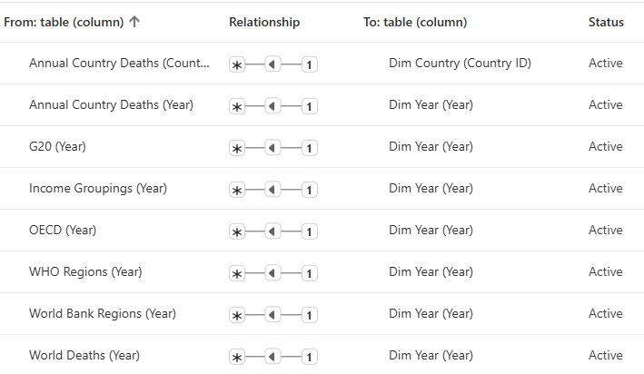
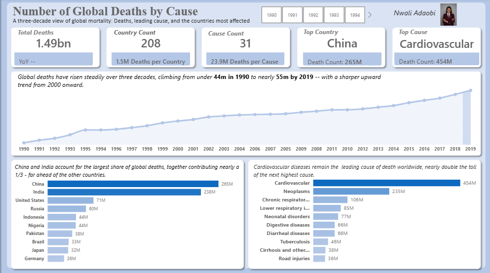
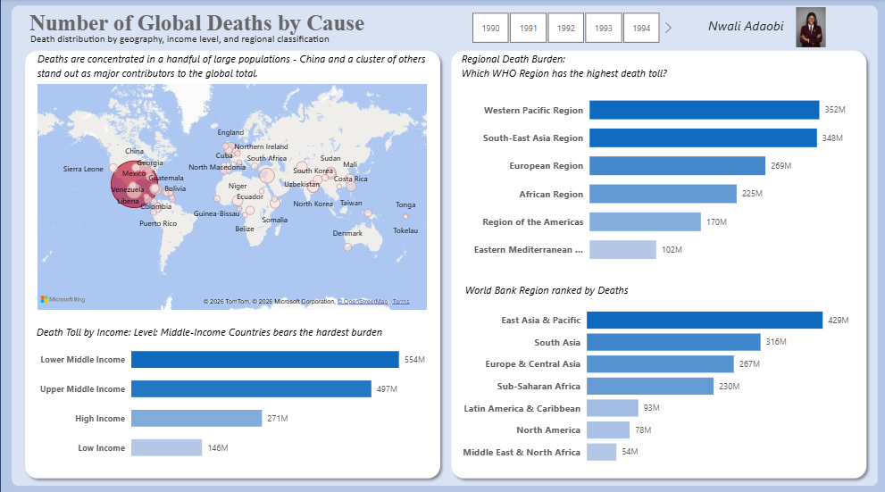

# NUMBER OF DEATHS BY CAUSE - *What Mortality rate looks like in 30 years* 

## Introduction
This project analyses global mortality trends over a 30-year period, examining the number of deaths attributed to different causes across countries. The analysis focuses on identifying the leading causes of death, tracking changes in mortality patterns over time, and highlighting countries with the highest death counts. The goal is to generate insights that support better understanding of global health challenges and inform public health planning and decision-making.

## Problem Statement
Understanding the major causes of death and their distribution across countries is essential for effective public health planning. However, without a clear analysis of long-term mortality trends, it is difficult to identify leading causes of death, track changes over time, and determine which countries bear the greatest mortality burden. 

This project addresses this gap by analyzing 30 years of mortality data to uncover key patterns, identify the leading causes of death, and highlight countries with the highest death counts.

## Data Sourcing
The dataset is a public-made dataset available on Kaggle for practical purpose, containing 6061 records from a period of 1990 to 2019.

The key fields include;
 - Country
 - Year
 - Causes

## Data Cleaning and Transformation
 - A backup copy of the raw data was made
 - Separated real countries from aggregates (World bank, income groups, WHO regions, OECD, World) to avoid double-counting
 - The Cause fields were unpivoted into Cause and Number, to easy DAX writing

## Data Modelling (Power BI)
A Galaxy Schema was built in Power BI to connect the fact tables to the Dimension tables

**Fact tables**
 - Annual Country Deaths
 - World Deaths
 - WHO Regions
 - World Bank Regions
 - Income Groupings
 - G20 Countries
 - OECD Countries
   
**Dimension tables**
 - Dim Country
 - Dim Year

**_View Relationships_**

## Analytics and Measures
 - **Total Deaths**: Represents the total number of deaths recorded across all causes and countries over the 30-year period. 
 - **Country Count**: Shows the total number of countries covered in the mortality analysis. 
 - **Cause Count**: Indicates the total number of distinct causes of death analyzed in the dataset. 
 - **Top Country**: Identifies the country with the highest recorded number of deaths across the period. 
 - **Top Cause**: Highlights the leading cause of death with the highest recorded number of deaths globally.

## Dashboard and Visuals
Two interactive dashboards were built to analyze the mortality rate in 30 years.

##Insights and Findings
The analysis recorded approximately **1.49 billion deaths** across 208 countries and 31 causes over the 30-year period. Global deaths increased from approximately 44 million in 1990 to nearly 55 million in 2019, with a more noticeable upward trend from 2000 onwards. The increasing number of deaths highlights the growing global mortality burden and the need for stronger public health interventions.

Cardiovascular diseases contribute disproportionately to global mortality, accounted for approximately **454 million deaths**, making them the leading cause of death globally. This is almost twice the 235 million deaths attributed to neoplasms (cancers), the second-leading cause. It highlights the importance of addressing heart-related conditions through prevention, early detection and effective treatment.

Global deaths are heavily concentrated in a few highly populated countries, particularly China and India. China recorded the highest number of deaths at approximately **265 million**, followed by India with **238 million**. Together, both countries accounted for approximately 503 million deaths, representing nearly **34%** of total global deaths.

Lower middle income countries account for the largest share of recorded deaths, approximately **554 million deaths**, suggesting the need to examine healthcare accessibility, disease prevention, healthcare infrastructure and socioeconomic conditions across income groups.

The Western Pacific and South-East Asia regions collectively account for a substantial proportion of global deaths, **352 million deaths** and **348 million deaths** respectively, making them important areas for targeted public health interventions.

## Recommendations
 - Prioritize healthcare investment in highly populated countries, particularly China and India.
 - Strengthen regional public health programs especially in the Western Pacific and South-East 
 - Asia to support targeted interventions in regions with the highest recorded deaths.
 - Establish continuous mortality monitoring and reporting systems to enable policymakers to identify emerging mortality patterns and make evidence-based decisions.
 - Strengthen cardiovascular disease prevention through routine screening, health education and early diagnosis.
 - Integrate Annual Population Data for Mortality Rate Analysis. This will enable more meaningful comparisons between countries with different population sizes and provide a better understanding of their relative mortality burden.

## Conclusion
The analysis reveals that global mortality is concentrated around a few major causes, countries and income groups. Cardiovascular diseases remain the leading cause of death, while China and India account for nearly one-third of all recorded deaths. Lower-middle-income countries also carry the largest mortality burden.

These findings highlight the importance of targeted healthcare investment, preventive healthcare programs and improved access to quality medical services.

## Author
Nwali Adaobi (Healthcare | BI Analyst)

